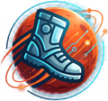
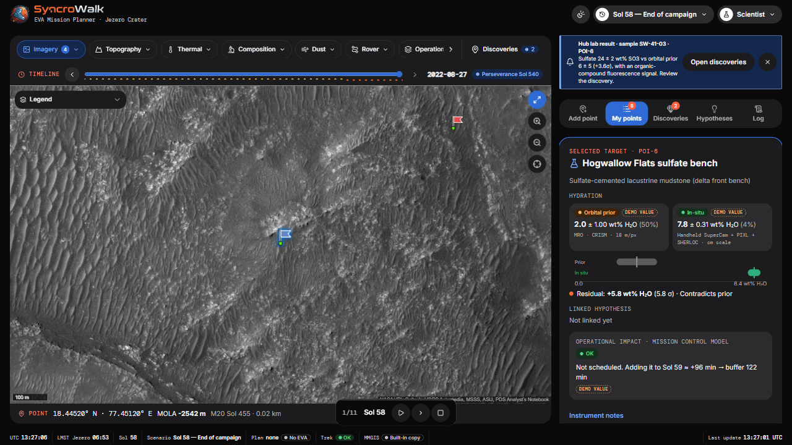
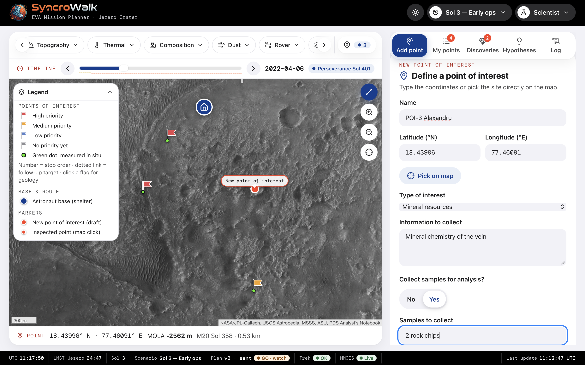
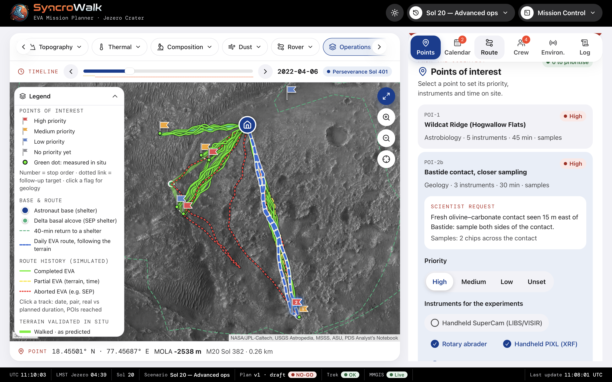
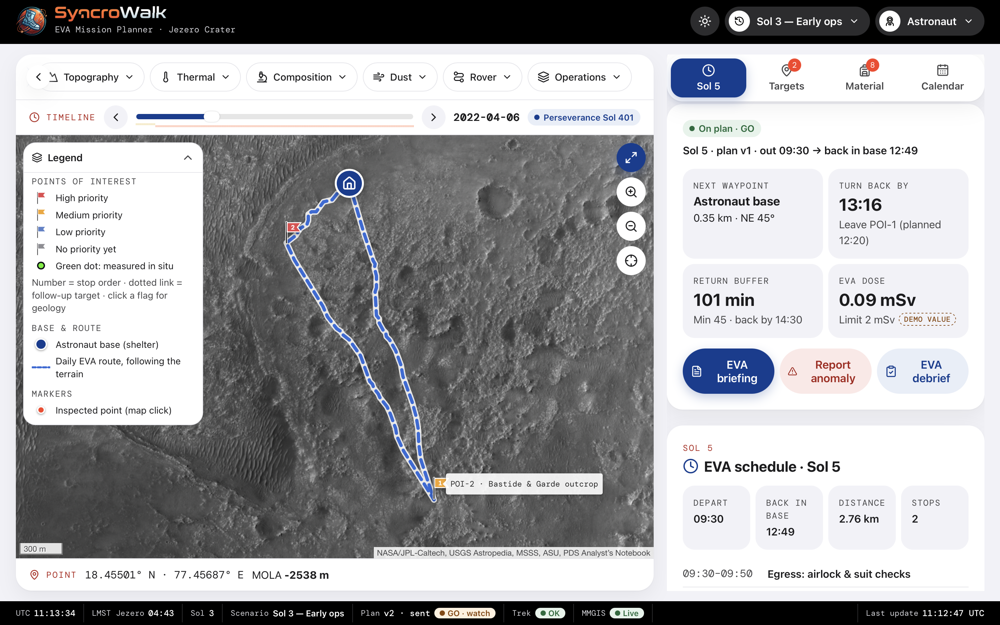
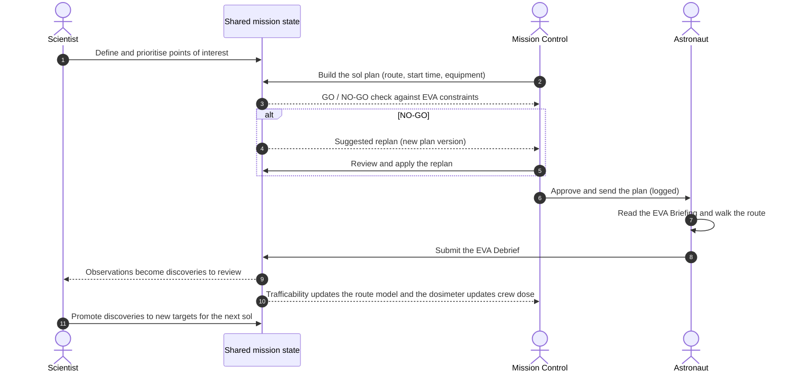
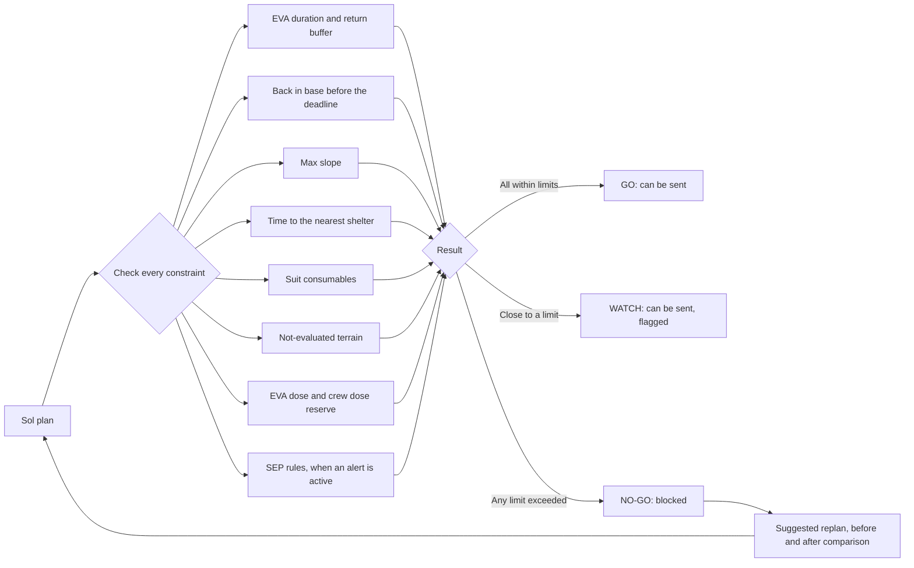
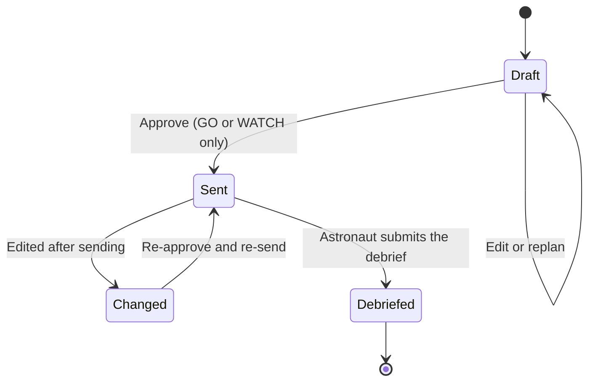
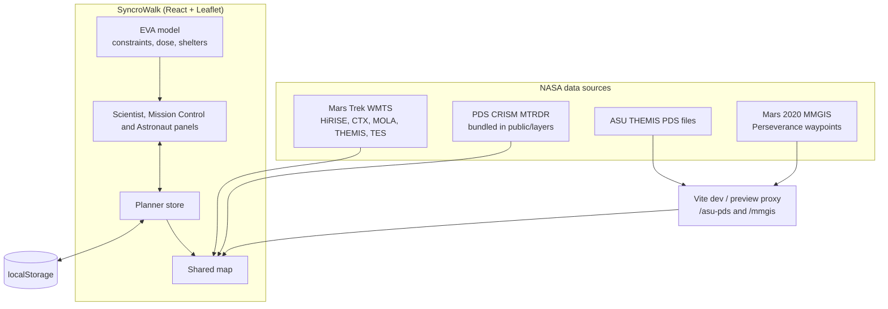

<div align="center">



# SyncroWalk

**EVA mission planning for the first human crews on Mars**

One shared map for the Scientist, Mission Control and the Astronaut, built on real NASA orbital data of Jezero Crater.

[](https://www.spaceappschallenge.org/)


</div>

---

## Overview

A rover takes several sols to go from an orbital map to a contact measurement, because every step waits for Earth. An astronaut on foot can do the same work in minutes. To use that speed, the plan has to change as fast as the data does.

**SyncroWalk** keeps three roles working on the same map and the same mission state:

| Role | Responsibility |
| :--- | :--- |
| **Scientist** | Defines points of interest, tests hypotheses, reviews field discoveries |
| **Mission Control** | Plans routes and the EVA calendar, checks safety, monitors crew and environment |
| **Astronaut** | Follows the approved EVA, reads the briefing, files the debrief after the walk |

Switching role never reloads the map. Each role sees only the layers and tools it needs.

> **Operations area:** Jezero Crater, Séítah unit and western delta front (18.44° N, 77.45° E)

---

## Demo

[](https://youtu.be/exAY5rXpp4o)

▶️ **[Watch the full 80-second demo on YouTube](https://youtu.be/exAY5rXpp4o)**

A hub lab result re-opens a low-priority target, the Sol 59 plan goes NO-GO on crew dose, and SyncroWalk re-plans it with the other EVA pair before the astronauts open their briefing.

---

## Screenshots

### Scientist
Points of interest, field discoveries and hypotheses on the shared map.



### Mission Control
Route planning, GO / NO-GO check, crew dose and replanning.



### Astronaut
The day's EVA, targets, equipment and the printable briefing.



---

## How it works

### The daily EVA loop

Each EVA closes a loop: the plan goes out, the crew walks, and what they find comes back into the next plan.



### GO / NO-GO decision

Every plan is checked again whenever it changes. A plan that breaks any limit is blocked and cannot be sent to the crew.



### Plan lifecycle



Every approval, replan and safety rule is written to the **mission log** with the plan version and the evidence behind it.

### Architecture

SyncroWalk is a single-page app with no backend. The mission state lives in the browser, and the map data comes from NASA services.



---

## Features

**Shared GIS map**
- Over 20 verified NASA Trek WMTS layers: HiRISE, CTX, MOLA, HRSC, THEMIS, TES and Viking
- Real **CRISM MTRDR** mineral maps (mafics, carbonates, phyllosilicates) from the PDS Geosciences Node
- **THEMIS surface temperature** read pixel by pixel from PDS files, with the value shown under the cursor
- The real **Perseverance traverse** and sol waypoints (MMGIS)
- Every layer shows its instrument and resolution. Terrain that has not been checked is shown in amber as *not evaluated*, never as safe.

**Scientist**
- Points of interest with priority, an orbital prior and in-situ measurements
- Discoveries reported by the crew, ready to be promoted to new targets
- Hypothesis tracking driven by the evidence collected so far

**Mission Control**
- Route planning with an elevation profile and a time, distance and consumables budget
- **GO / NO-GO** check against EVA duration, return buffer, slope, time to shelter, suit consumables, not-evaluated terrain and radiation dose
- **Replanning:** a NO-GO plan cannot reach the crew. SyncroWalk suggests a fix, compares the plan before and after, and keeps every version.
- A crew of four with a rotating EVA pair, plus dose budget, fatigue and vitals for each member
- Environment monitoring with a scripted **SEP (solar particle event) alert** and pre-authorised shelter rules

**Astronaut**
- A clean field view: targets, equipment and calendar, with no spectral clutter
- A printable **EVA Briefing** before leaving the base
- An **EVA Debrief** form. Observations, trafficability and dosimeter readings go straight back to the Scientist and Mission Control.

**Mission log**
- Every science, safety and replanning decision is recorded with its sol, local time, plan version and evidence

---

## Demo scenarios

Pick a scenario from the top bar to load a complete mission history:

| Scenario | What it shows |
| :--- | :--- |
| **Sol 1 · Landing** | Orbital priors only. Nothing has been measured or validated yet, so uncertainty is at its highest. |
| **Sol 3 · Early ops** | The first two EVAs have been debriefed. A soft-soil report moved a route and a new POI was promoted. |
| **Sol 20 · Advanced ops** | 16 EVAs: route history, terrain validated in situ, two SEP events, one astronaut out of dose budget. |
| **Sol 24 · Live ops** *(default)* | A plan has been sent, the next day's draft is NO-GO and there is an SEP drill in Mission Control. |
| **Sol 58 · End of campaign** | A hub lab result on a Sol 41 sample re-opens a low-priority target. The Sol 59 plan goes NO-GO on crew dose and is re-planned with the other EVA pair. |

### Scripted demo (80 seconds)

Open **http://localhost:5173/?demo=sol58**, or choose **Play the scripted demo · Sol 58** in the scenario menu. The demo plays the Sol 58 story on its own in 11 steps, using the same actions as the buttons: lab result → priority change → NO-GO → crew dose check → replan → approval → astronaut briefing.

| Key | Action |
| :--- | :--- |
| `Space` | Pause / resume |
| `→` | Next step |
| `Esc` | Stop the demo |

Use **Reset demo** in the user menu to restore the starting data. The mission state is saved in the browser (`localStorage`).

> Scenario histories, crew data and the numbers in the EVA model are **illustrative demo values**. Map layers, CRISM products, THEMIS temperatures and the Perseverance traverse are **real NASA data**.

---

## Getting started

**Requirements:** Node.js 20.19+ (or 22.12+) and npm

```bash
git clone https://github.com/Dacfor/SyncroWalk.git
cd SyncroWalk
npm install
npm run dev
```

Then open **http://localhost:5173**.

| Command | Description |
| :--- | :--- |
| `npm run dev` | Start the development server |
| `npm run build` | Type-check and build for production |
| `npm run preview` | Serve the production build locally |
| `npm run lint` | Lint with Oxlint |

> THEMIS temperature files and Perseverance waypoints come from servers that do not allow cross-origin requests. SyncroWalk reads them through the built-in Vite proxy, so run the app with `npm run dev` or `npm run preview`. A plain static deploy will not load those two layers.

---

## Project structure

```text
SyncroWalk/
├── public/
│   └── layers/crism/         # CRISM MTRDR browse products (real PDS data, see its README)
├── src/
│   ├── components/
│   │   ├── MissionPlanner.tsx    # Map, layers and app layout
│   │   └── planner/
│   │       ├── ScientistPanel.tsx    # Scientist view
│   │       ├── ControlPanel.tsx      # Mission Control view
│   │       ├── AstronautPanel.tsx    # Astronaut view
│   │       ├── Briefing.tsx          # Printable EVA briefing
│   │       ├── Debrief.tsx           # Post-EVA debrief form
│   │       ├── Replan.tsx            # NO-GO → replan comparison
│   │       ├── analysis.ts           # EVA model: dose, slope, shelters, constraints
│   │       ├── model.ts              # Mission state types and seed data
│   │       ├── usePlannerStore.ts    # Shared state and persistence
│   │       └── scenarios/            # Sol 1 · Sol 3 · Sol 20 histories
│   ├── logo/
│   └── styles/
└── vite.config.ts            # Includes the THEMIS and MMGIS data proxy
```

---

## Data sources

| Source | Used for |
| :--- | :--- |
| [NASA Mars Trek](https://trek.nasa.gov/mars/) WMTS | HiRISE, CTX, MOLA, HRSC, THEMIS, TES and Viking base layers |
| [PDS Geosciences Node](https://pds-geosciences.wustl.edu/) | MRO CRISM MTRDR mineral browse products |
| [ASU THEMIS / PDS](https://static.mars.asu.edu/) | THEMIS brightness-temperature observations |
| [Mars 2020 MMGIS](https://mars.nasa.gov/mars2020/mission/where-is-the-rover/) | Perseverance traverse and waypoints |
| MSL RAD (Hassler et al., 2014) | Reference value for the background radiation dose |

NASA data are in the public domain. Credit: NASA / JPL-Caltech / USGS / ASU / JHU-APL.

---

## Contributing

Contributions are welcome. Read [CONTRIBUTING.md](CONTRIBUTING.md) for the branch strategy, coding standards and pull request checklist.

<div align="center">
<br />
<sub>Built for the <b>NASA Space Apps Challenge</b>: <i>Interplanetary Survival Guide: Martian Map</i></sub>
</div>
