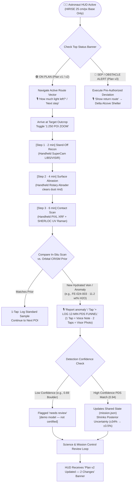

# 🪐 SyncroWalk (MARSWALK v5)

**Role-Adaptive EVA Mission Planning & In-Situ Bayesian Decision System for Human Mars Exploration**

*Developed for the NASA Space Apps Challenge — Interplanetary Survival Guide: Martian Map*

🔗 **Repository:** [github.com/Dacfor/SyncroWalk](https://github.com/Dacfor/SyncroWalk)

📍 **Target Operations Area:** Jezero Crater — *Séítah* Unit & Western Delta Front ($18.4365^\circ\text{ N}, 77.4565^\circ\text{ E}$)

---

## 📖 Executive Summary: Compressing the Rover Decision Funnel

Uncrewed Martian rovers (*Perseverance*, *Curiosity*) operate through a slow, multi-sol **"decision funnel"**:

1. **Orbital Reconnaissance** (`MRO/CRISM`, `HiRISE`): maps broad mineralogical units ($18\text{ m/px}$) with high compositional uncertainty ($\sigma \approx \pm 32\%\text{–}36\%$).
2. **Stand-Off Reconnaissance** (`SuperCam` / `ChemCam`): fires LIBS/VISIR lasers from $2\text{–}7\text{ m}$ $\rightarrow$ *Requires* $\ge 1\text{ Sol}$ *of Earth-in-the-loop downlink and planning*.
3. **Robotic Arm Approach & Surface Abrasion**: clears weathered surface dust rinds $\rightarrow$ *Requires* $1+\text{ Sol}$ *of command validation*.
4. **Contact Analysis & Coring** (`PIXL` XRF + `SHERLOC` Raman) $\rightarrow$ *Spans multiple operational Sols*.

A suited astronaut equipped with handheld diagnostic equivalents compresses this $4\text{-Sol}$ sequence into **12 minutes on-site**. **SyncroWalk** is the operational software platform designed to make that speed actionable: **it moves the decision next to the data**, synchronizing the **Science Team**, **Mission Control**, and the **Astronaut HUD** around a single, persistent planetary map.

To ground the simulation in real planetary telemetry, SyncroWalk ingests authentic **NASA Planetary Data System (PDS) Analyst's Notebook** records from **Séítah and the Jezero Western Delta** (`SuperCam`, `PIXL`, `SHERLOC`, `MEDA`, and `MMGIS` traverse feeds), demonstrating a live **Bayesian update of orbital CRISM a-priori mineral estimates** using in-situ contact measurements.

---

## 🔄 Operational & Voice Dialogflow (Mermaid Diagrams)

### 1. Closed-Loop Multi-Role Decision & Replanning Dialogflow
This sequence diagram illustrates how **SyncroWalk** connects the **Scientist**, **Mission Control**, and the **Astronaut HUD** (via voice commands and glove-friendly touch targets) around the shared `mission.json` state across the 3-Sol scenario:

```mermaid
sequenceDiagram
    autonumber
    actor SCI as 👨‍🔬 Scientist Lens
    participant MAP as 🗺️ Shared GIS & State (mission.json)
    actor MCC as 🛰️ Mission Control Lens
    actor HUD as 🧑‍🚀 Astronaut HUD (Voice / Glove UI)

    rect rgb(18, 24, 31)
    Note over SCI,HUD: SOL 1 — ORBITAL PRIOR BASELINE (Plan v1)
    SCI->>MAP: Inspect MRO/CRISM Prior (18 m/px, σ = ±34%) & PDS Waypoints
    SCI->>MCC: Propose prioritized POI queue (POI-1 Wildcat Ridge → POI-2 Bastide)
    MCC->>MAP: Run Route Optimizer (Compare Route A vs. Route B + MOLA Slope >15°)
    MAP-->>MCC: Reject Route B (+24 min over EVA return buffer in Séítah sand)
    MCC->>HUD: Approve & Dispatch Plan v1 (Route A · Window 09:30–14:30 LST)
    end

    rect rgb(22, 34, 47)
    Note over SCI,HUD: SOL 2 — COMPRESSED 12-MIN FIELD FUNNEL & BAYESIAN UPDATE (Plan v2)
    HUD->>HUD: 🎙️ Voice / Tap: "Next step" / "Show 1:250 POI Zoom"
    HUD->>MAP: Step 1 (2 min): Handheld SuperCam Stand-Off LIBS/VISIR
    HUD->>MAP: Step 2 (4 min): Handheld Rotary Surface Abrasion
    HUD->>MAP: Step 3 (6 min): Handheld PIXL XRF + SHERLOC Raman Scan
    HUD->>MAP: 🎙️ Voice / Tap: "Report anomaly" → Log FE-024-003 (11.2 wt% H2O Vein)
    MAP-->>SCI: Trigger Bayesian Fusion Update (Uncertainty shrinks ±34% → ±3.5%)
    SCI->>MCC: Slide Prior↔Posterior & Promote FE-024-003 to POI-4 [HIGH]
    MCC->>HUD: Re-optimize & Dispatch Plan v2 (Route A-Mod · 2 Changes Diff Banner)
    end

    rect rgb(45, 20, 24)
    Note over SCI,HUD: SOL 3 — PRE-AUTHORIZED SAFETY CONTINGENCY (Plan v3)
    MAP-->>MCC: ⚠️ Scripted DONKI SEP Alert (>35 PFU) + MEDA Dust Front
    MCC->>HUD: Dispatch Plan v3 (Pre-Authorized Rule: Shorten EVA + Shelter Spur)
    HUD->>HUD: 🚨 Red Banner: "ALERT: SEP SHELTER RULE — Divert to Delta Basal Alcove"
    HUD->>MAP: 🎙️ Voice / Tap: "Show return route" → Acknowledge & Execute Shelter Spur
    end
```



### 2. Astronaut HUD Voice & Glove Interaction Flow (Dialogflow State Machine)
The Astronaut HUD enforces zero planning clutter (`< 3 s` scan time, $\ge 64\text{ px}$ touch targets). Every physical button is mirrored by a deterministic voice command:



---

## ✨ Key Capabilities

* **🗺️ Single Persistent GIS Canvas (`L.CRS.EPSG4326`)**:
  Switching between the 3 authenticated user roles (**Scientist**, **Mission Control**, **Astronaut HUD**) never reloads or repositions the map. It dynamically updates role-specific **3-filter presets**, vector overlays, and decision permissions.
* **🔬 Bayesian Prior-to-Posterior Data Fusion**:
  Interactive *Before/After* split comparison between low-resolution orbital mineral priors (`MRO/CRISM 18 m/px`, $\sigma = \pm 34\%$ uncertainty) and posterior maps fused with PDS contact measurements (`PIXL` XRF + `SHERLOC` Raman, shrinking local uncertainty to $\sigma = \pm 3.8\%$).
* **⚡ Rapid Field Funnel Sequencer (Astronaut HUD)**:
  Glove-friendly ($\ge 64\text{ px}$ touch targets, readable in $<3\text{ s}$) 3-step field protocol (*Stand-Off Recon* $2\text{ min}$ $\rightarrow$ *Surface Abrasion* $4\text{ min}$ $\rightarrow$ *Contact Scan* $6\text{ min}$) replacing multi-sol rover loops.
* **🛡️ Full Data Provenance & Safety Traceability**:
  * Every layer and telemetry value displays its **Mission + Instrument + Spatial Resolution** badge.
  * Unverified terrain is strictly rendered in amber (`#E5C04A`) as **`Not evaluated`**, never assumed green/safe.
  * **Plan Versioning (`v1`** $\rightarrow$ **`v2`** $\rightarrow$ **`v3`)** logs timestamps, operational triggers (e.g., *PDS carbonate discovery*, *DONKI SEP radiation alert*), approving authority, and safety rationale.
* **📡 Real Planetary Streaming & Byte-Range Elevation**:
  Streams verified **NASA Mars Trek WMTS** rasters, queries real point elevations from the global **USGS MOLA Cloud Optimized GeoTIFF (COG)** via `HTTP Range` requests (`geotiff.js`), and overlays live **Mars 2020 MMGIS** rover waypoints.

---

## 🗂️ Project Structure

```text
SyncroWalk/
├── README.md                     # Official documentation, setup guide & architecture roadmap
├── backend/
│   ├── proxy.py                  # Asynchronous FastAPI CORS & HTTP Range caching proxy
│   └── requirements.txt          # Python dependencies (fastapi, uvicorn, httpx)
├── frontend/
│   ├── package.json              # Frontend dependencies & Vite scripts
│   ├── vite.config.js            # Vite bundler & dev server config (port 5173)
│   ├── tailwind.config.js        # Mission Control design tokens (#0b0f14, #2D7FF9, #FF6B35)
│   ├── postcss.config.js         # PostCSS configuration
│   ├── index.html                # App shell (Inter + IBM Plex Mono fonts)
│   └── src/
│       ├── main.jsx              # React DOM entry point
│       ├── index.css             # Tailwind CSS directives & base dark-mode typography
│       └── App.jsx               # Main React application (Persistent Map + 3 Role Lenses + PDS)
└── prototype-vanilla/
    └── index.html                # Standalone HTML/ESM prototype for direct WMTS/COG verification
```

---

## 🚀 Getting Started (Installation & Execution)

### Prerequisites

* **Node.js** ($\ge 18.0.0$) and **npm** (for the React + Vite frontend)
* **Python** ($\ge 3.10$) (optional but recommended for the FastAPI CORS & `HTTP Range` proxy)

### 1. Clone the Repository

```bash
git clone https://github.com/Dacfor/SyncroWalk.git
cd SyncroWalk
```

### 2. Backend Setup (Python Virtual Environment & FastAPI Proxy)

While NASA Mars Trek WMTS tiles and USGS S3 GeoTIFFs support open CORS directly in the browser, running the local FastAPI proxy (`backend/proxy.py`) enables in-memory caching ($1\text{-hour}$ TTL) and seamless forwarding of `Range` headers for PDS/MMGIS endpoints.

#### On macOS / Linux:

```bash
cd backend
python3 -m venv .venv
source .venv/bin/activate
pip install --upgrade pip
pip install -r requirements.txt
uvicorn proxy:app --host 127.0.0.1 --port 8000 --reload
```

#### On Windows (PowerShell):

```powershell
cd backend
python -m venv .venv
.\.venv\Scripts\Activate.ps1
pip install --upgrade pip
pip install -r requirements.txt
uvicorn proxy:app --host 127.0.0.1 --port 8000 --reload
```

#### On Windows (Command Prompt / `cmd.exe`):

```cmd
cd backend
python -m venv .venv
.venv\Scripts\activate.bat
pip install --upgrade pip
pip install -r requirements.txt
uvicorn proxy:app --host 127.0.0.1 --port 8000 --reload
```

> **Verification:** Once running, the proxy listens at `http://localhost:8000/proxy?url=`. Interactive Swagger API documentation is available at `http://localhost:8000/docs`. Inside the web app top bar, click **`Direct CORS (Trek/USGS)`** to toggle **`Proxy :8000 ON`**.

### 3. Frontend Setup (React + Vite + Tailwind CSS)

Open a **second terminal window** from the project root:

```bash
cd frontend
npm install
npm run dev
```

> **Verification:** Vite will start the development server and automatically open **`http://localhost:5173`** in your browser.

### 4. Production Build (Optional)

To compile and preview the optimized production bundle:

```bash
cd frontend
npm run build
npm run preview
```

---

## 🎮 Role-Based Architecture & Simulated 3-Filter Presets

Switching the authenticated user in the top navigation bar dynamically reconfigures the map's active layers without altering the camera viewport:

| Authenticated Role | Auto-Activated Map Filters (3 Presets) | Core Operational Responsibility |
| :--- | :--- | :--- |
| **👨‍🔬 1. Scientist** *(Default)* | 1. **CRISM Prior $\leftrightarrow$ PDS Posterior** (`TES Clay` + Bayesian fusion polygons)<br>2. **THEMIS Thermal ($100\text{ m/px}$)** (`THEMIS Night IR` bedrock vs. sand)<br>3. **HiRISE $25\text{ cm}$ + PDS Targets** (`MMGIS` traverse + PDS Notebook POIs) | Compare orbital priors against in-situ PDS measurements, promote newly discovered outcrops (`FE-024-003`) to `HIGH` priority POIs, and propose the daily target queue. |
| **🛰️ 2. Mission Control** | 1. **MOLA+HRSC Slope & NE Zones** ($200\text{ m/px}$ DEM + $>15^\circ$ red scarp + amber `Not evaluated` zones)<br>2. **TES Dust & MEDA Context** (`TES Dust` + historical `MEDA`/`RAD` telemetry)<br>3. **Candidate EVA Routes** (`Route A`, `Route A-Mod`, `Route B`, `Shelter Spur`) | Evaluate traverse safety in $< 1\text{ minute}$, compare route candidates against EVA return buffers ($45\text{ min}$) and daylight windows (`09:30–14:30`), and publish versioned plans (`v1 → v2 → v3`). |
| **🧑‍🚀 3. Astronaut HUD** | 1. **High-Res Surface Base ONLY** (`HiRISE 25 cm/px` + `CTX 6 m/px`, spectral overlays OFF)<br>2. **Active Approved Route & Target Vector**<br>3. **Field Funnel & Hazard Markers** | Read critical navigation state in $< 3\text{ seconds}$, execute the $12\text{-minute}$ handheld analytical funnel, toggle `1:250 POI ZOOM`, and log geolocated readings with 1 tap. |

---

## ⏱️ 90-Second Guided Demo Script (`DEMO: Sol 1 · Sol 2 · Sol 3`)

Use the **`DEMO: [Sol 1: Prior] [Sol 2: 12m Funnel] [Sol 3: SEP Alert]`** stepper in the top bar to walk judges through a complete $3\text{-Sol}$ closed-loop replanning scenario:

1. **`Sol 1: Prior` ($0\text{–}30\text{ s}$ — Orbital Prior Baseline):**
   * Start as **`👨‍🔬 Scientist`**. Inspect the 3 initial POIs (*Wildcat Ridge*, *Bastide*, *Skinner Ridge*) selected from `MRO/CRISM` orbital priors ($\sigma = \pm 32\%$). Click anywhere on the map to read the real `MOLA` elevation and nearest *Perseverance* Sol waypoint.
   * Switch to **`🛰️ Mission Control`**: the Route Optimizer selects `Route A` ($2.15\text{ km}$, $+65\text{ min}$ buffer) and explicitly logs why `Route B` is rejected ($+24\text{ min}$ over EVA return buffer due to *Séítah* sand ripples and a $19.4^\circ$ scarp).
2. **`Sol 2: 12m Funnel` ($30\text{–}65\text{ s}$ — The Compressed Funnel & Bayesian Update):**
   * Switch to **`🧑‍🚀 Astronaut HUD`** (or click **`Sol 2: 12m Funnel`**). The astronaut executes the 3-step handheld funnel (`SuperCam` $\rightarrow$ `Abrader` $\rightarrow$ `PIXL/SHERLOC`) in $12\text{ minutes}$ **instead of** $4\text{ Rover Sols}$ on outcrop `FE-024-003`, discovering a sub-meter fracture vein with $11.2\text{ wt\% }\text{H}_2\text{O}$ invisible to $18\text{ m/px}$ orbital `CRISM`.
   * Return to **`👨‍🔬 Scientist`**: drag the **`CRISM Prior ↔ PDS Posterior`** slider to watch compositional uncertainty shrink from $\pm 34\%$ to $\pm 3.5\%$ and promote the discovery to **`POI-4 [HIGH]`**.
   * In **`🛰️ Mission Control`**, the route automatically adapts to **`Route A-Mod`**, generating **`Plan v2`** with full audit traceability.
3. **`Sol 3: SEP Alert` ($65\text{–}90\text{ s}$ — Pre-Authorized Contingency Response):**
   * Click **`Sol 3: SEP Alert`**: a scripted `DONKI SEP` solar proton advisory ($>35\text{ PFU}$) and `MEDA` dust gust front trigger pre-authorized safety rules (**`Plan v3`**).
   * Without any fake HUD autonomy, the route diverts along the orange **`Shelter Spur`** to the *Delta Basal Alcove Shelter*, postponing distant POIs and displaying an immediate red directive banner on the Astronaut HUD.

---

## 📊 Planetary Data Sources & Attribution

* **NASA Mars Trek WMTS:** `HiRISE SOC_006` ($25\text{ cm/px}$), `CTX SOC_008` ($6\text{ m/px}$), `MOLA+HRSC Blended Shade` ($200\text{ m/px}$), `THEMIS Night IR` ($100\text{ m/px}$), `TES Mineral & Dust`.
* **USGS Astrogeology Science Center:** Global `MGS MOLA DEM` Cloud Optimized GeoTIFF (`mola128_mola64_merge_90Nto90S_SimpleC_clon0_cog.tif`).
* **NASA/JPL Mars 2020 MMGIS:** Official *Perseverance* traverse polyline (`M20_traverse.json`) and Sol waypoints (`M20_waypoints.json`).
* **NASA PDS Geosciences & Atmospheres Nodes (Analyst's Notebook):** In-situ reference packages for `SuperCam`, `PIXL`, `SHERLOC`, and `MEDA` across *Séítah* (*Bastide / Guillaumes*) and the *Western Delta* (*Wildcat Ridge / Berry Hollow / Skinner Ridge*).

---

## 🛠️ Technical Roadmap & Next Improvements

1. **FastAPI Lifespan & Bounded LRU Cache (`backend/proxy.py`)**:
   * Manage `httpx.AsyncClient` via FastAPI's `@asynccontextmanager` lifespan handler and replace the unbounded in-memory dictionary with a bounded `TTLCache` (e.g., max $128$ entries) to prevent memory growth during extended sessions.
2. **Bundled NPM GIS Dependencies (`leaflet` & `geotiff`)**:
   * Bundle `leaflet` and `geotiff` directly via Vite (`npm install leaflet geotiff`) rather than dynamic CDN injection to guarantee $100\%$ offline stage reliability.
3. **Cross-Tab Real-Time Sync (`BroadcastChannel` / `localStorage`)**:
   * Synchronize `mission.json` state across browser windows so judges can view **Mission Control** on one screen and the **Astronaut HUD** on a second screen updating simultaneously in real time.
4. **Single-Command Orchestration (`docker-compose.yml`)**:
   * Provide a root `docker-compose.yml` and `Makefile` (`make dev`) to spin up both the FastAPI proxy (`:8000`) and Vite frontend (`:5173`) in a single command.